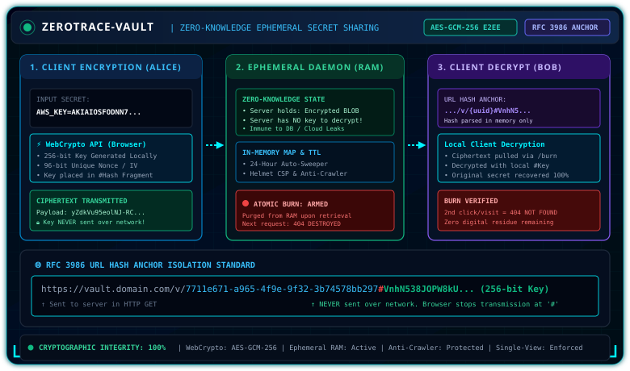

<div align="center">

# 🛡️ ZeroTrace-Vault — Zero-Knowledge Ephemeral Secret Sharing Vault

[](https://github.com/Atulkumar5772/ZeroTrace-Vault)
[](https://zerotrace-vault.onrender.com)
[](https://developer.mozilla.org/en-US/docs/Web/API/SubtleCrypto/encrypt)
[](https://datatracker.ietf.org/doc/html/rfc3986)
[](https://nodejs.org/)
[](LICENSE)

<br><br>



<br>

*An enterprise-grade, end-to-end zero-knowledge secret orchestration engine designed to eliminate credential sprawl in corporate communications. Built with client-side WebCrypto AES-GCM-256, RFC 3986 URL-hash key isolation, and an atomic single-view burn-on-read ephemeral engine.*

</div>

---

## 📌 1. The Real-World Incident & Why This Exists

In the **Uber 2022 Breach**, an attacker compromised the entire corporate AWS infrastructure and VPN network simply because a DevOps engineer shared admin credentials in an internal **Slack channel**. The attacker ran a simple search query: `search "AWS_SECRET_ACCESS_KEY"` and gained root access.

Corporate chats (Slack, WhatsApp, Teams, Emails) are **permanent, indexed, searchable databases**. Credentials shared there remain vulnerable indefinitely.

### Why Existing Tools (Pastebin/Privnote) Fail:
Most pastebins encrypt on the server side or hold plaintext credentials in memory. If the server is compromised or an admin goes rogue, all secrets are leaked.

---

## 🎯 2. The Zero-Knowledge Guarantee (RFC 3986 Anchor Isolation)

`ZeroTrace-Vault` guarantees that **even the system owner or cloud hosting provider CANNOT read the shared secrets.**

### How the `#` Anchor Isolation Works:
1. Alice's browser/CLI generates a **256-bit AES-GCM** key locally.
2. The secret is encrypted on the client machine.
3. The server receives **ONLY** the ciphertext and 96-bit IV. **The key is NEVER sent over the wire.**
4. A unique URL is generated:
   `https://vault.domain.com/v/c0ed7d19...#knN2IeVIVu...`
5. According to **RFC 3986**, web browsers **never transmit the hash fragment (`#...`) in HTTP requests**. The key remains strictly in Bob's browser memory.

```text
[ Alice Browser/CLI ] ──(AES-GCM-256 + IV)──> Ciphertext ──> [ ZeroTrace Server ] ──> [ Ephemeral RAM ]
          │                                                                                 ▲
          └──────> URL: https://vault.dev/v/{UUID}#{Key}                                     │
                             │                                                             │
  [ Bob Browser ] <──────────┴──────── (Fetch Ciphertext & Burn) ──────────────────────────┘
    (Decrypts locally using #Key)
```

---

## 🔥 3. Strict Single-View Policy (Burn-on-Read)

1. **Pre-flight Crawl Protection (`/api/v1/secret/:id/meta`):**  
   Social link crawlers (Slackbot, WhatsApp, Discord) fetching link previews **will NOT destroy the secret**.
2. **Atomic Burn Execution (`/api/v1/secret/:id/burn`):**  
   When Bob clicks **"Reveal Secret"**, the server retrieves the payload and **instantly purges it from RAM**.
3. **Second Attempt Defense:**  
   Any subsequent request with the same UUID immediately yields `404 Not Found`.

---

## 🛠️ 4. Technology Stack

<div align="center">

| Layer | Technologies | Description |
| :--- | :--- | :--- |
| **Cryptography** | Browser Native WebCrypto API (SubtleCrypto) | AES-GCM-256 bit encryption, 96-bit unique IVs, 0 external crypto dependencies |
| **Backend Core** | Node.js, Express.js | High-throughput REST API, bounded ephemeral in-memory storage map |
| **Security Hardening** | Helmet.js, Custom Sliding-Window Rate Limiter, Strict CORS | Strict CSP (no `unsafe-inline`), Anti-Clickjacking, `no-store` caching, IP sliding-window rate limit (30 req/min) |
| **Frontend UI** | Modern HTML5, Responsive CSS3, Vanilla JS | Dark cyber glassmorphic operations console, real-time TTL burn countdown |
| **CLI Client** | Node.js CLI Script (`zerotrace-cli.js`) | Direct HTTP/HTTPS secret sharing and UNIX pipeline integration (`cat file \| node cli`) |
| **Containerization** | Docker, Docker Compose, Render Blueprint | Production non-root container & 1-click `render.yaml` deployment |

</div>

---
## 🌐 Live Demo

🔗 **Live Website:** [https://zerotrace-vault.onrender.com](https://zerotrace-vault.onrender.com)

🔗 **GitHub Repository:** [https://github.com/Atulkumar5772/ZeroTrace-Vault](https://github.com/Atulkumar5772/ZeroTrace-Vault)

---

## 📂 5. Project Structure

```text
ZeroTrace-Vault/
├── assets/
│   └── zerotrace-preview.svg                    # End-to-end cryptographic architecture diagram
├── backend/
│   ├── package.json                             # Dependencies: express, helmet, cors
│   └── src/
│       ├── server.js                            # Daemon entry point & graceful store cleanup
│       ├── routes.js                            # REST API endpoints (/create, /meta, /burn)
│       ├── vaultStore.js                        # Bounded ephemeral RAM store, UUID & Base64URL validation, TTL sweeper
│       └── rateLimiter.js                       # Sliding-window IP rate limiter
├── cli/
│   └── zerotrace-cli.js                         # Terminal pipe tool for developers (HTTP & HTTPS)
├── frontend/
│   └── public/
│       ├── index.html                           # Web vault interface
│       ├── style.css                            # Cyber glassmorphic styling
│       ├── crypto.js                            # Client-side WebCrypto AES-GCM-256 implementation
│       └── app.js                               # DOM handling, burn triggers, clipboard copy
├── tests/
│   └── comprehensive_test.js                   # 8/8 automated security & lifecycle verification tests
├── docker-compose.yml                           # One-click Docker deployment
├── Dockerfile                                   # Production Node.js container
├── test_verification.js                         # Quick end-to-end test script
├── LICENSE                                      # MIT License
└── README.md                                    # Comprehensive engineering documentation
```

---

## 💻 6. Running Locally

### 1. Start the Vault Server:
```bash
cd backend
npm install
npm start
```
Server opens at:
```text
http://localhost:3000
```

### 2. CLI Tool Usage (Terminal / Pipes):
```bash
# Share a direct string against local server
node cli/zerotrace-cli.js "my-production-token"

# Or pipe output from any command:
cat ~/.ssh/id_rsa | node cli/zerotrace-cli.js

# Or target a remote HTTPS deployment (e.g. Render):
ZEROTRACE_URL=https://zerotrace-vault.onrender.com node cli/zerotrace-cli.js "my-production-token"
```

---

## 🧪 7. Automated Verification

Run the end-to-end cryptographic and burn test suite:
```bash
node test_verification.js
```

Or run the full production security & adversarial test suite (starts an isolated test server automatically or targets `PORT`):
```bash
node tests/comprehensive_test.js
```

Expected checks:
* ✅ Backend Daemon Healthcheck & No Active-Count Leak
* ✅ Reject Malformed / Non-Base64URL & Invalid IV/Tag Lengths
* ✅ Reject Oversized Secret Payload (> 512 KB)
* ✅ End-to-End Cryptographic Secret Lifecycle & Whitespace Preservation
* ✅ Preflight Metadata Check (Preview Bot Anti-Burn Verification)
* ✅ Atomic Burn-on-Read & 20-Way Concurrent Race Condition Test
* ✅ Replay Attack Prevention (`404` after Burn)
* ✅ Strict CORS Rejection, `X-Forwarded-For` Spoof Immunity, Error Status Codes (`400`/`413`), `Cache-Control: no-store`, and CLI End-to-End Test

---

## 📄 License

This project is licensed under the [MIT License](LICENSE).

---

## 👨‍💻 Author

<div align="center">

### Atul Kumar
**Computer Science Student @ PIET Jaipur (2024–2028) • Red Hat Intern • Salesforce Developer**

<p align="center">
  <a href="https://github.com/Atulkumar5772" target="_blank">
    
  </a>
  &nbsp;
  <a href="https://www.linkedin.com/in/atul-kumar-454b34380/" target="_blank">
    
  </a>
</p>

</div>
